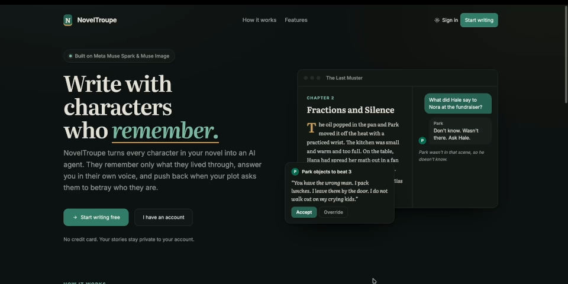
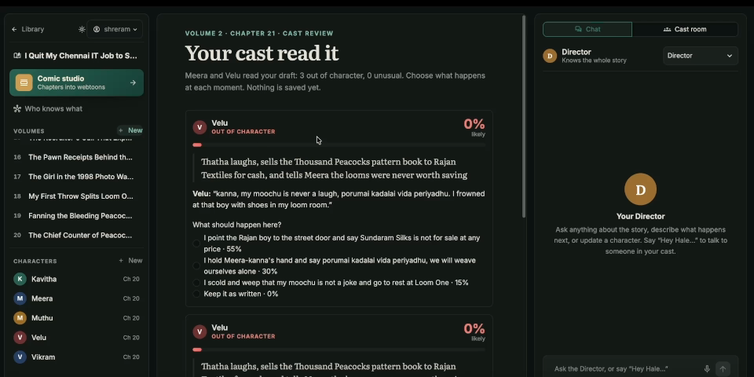
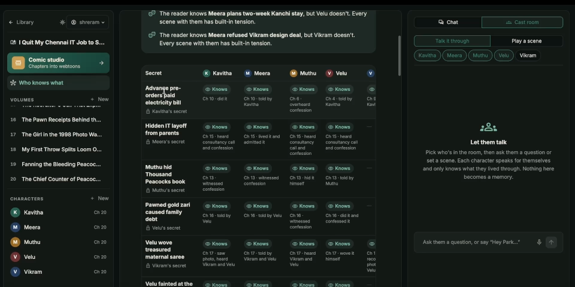
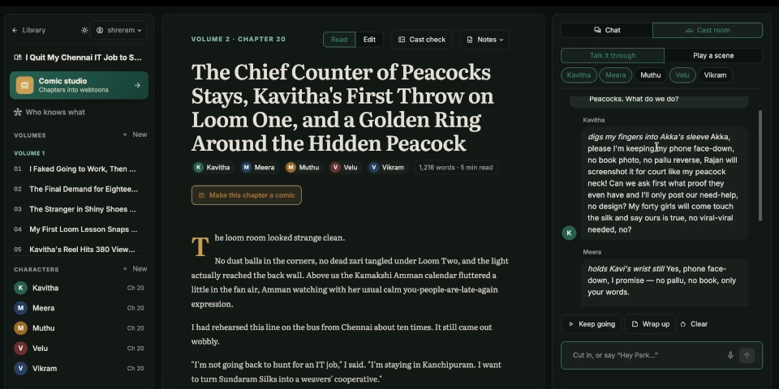
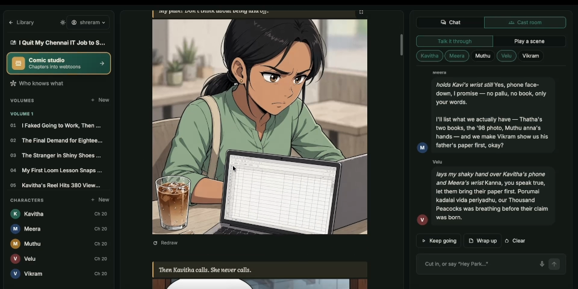

# NovelTroupe

**Write with characters who remember.**

NovelTroupe is a writing studio where every character in your novel is their own AI agent. They remember only the scenes they lived through, answer you in their own voice, and push back when a chapter asks them to act against who they've become. A Director agent plans each chapter with you, and you can type or simply talk.

Built for the Meta Global AI Developer Hackathon with Streamlit, plain JSON files for storage, and the `openai` Python SDK pointed at the Meta Model API: **Muse Spark** (`muse-spark-1.3`) runs every agent and **Muse Image** (`muse-image-1.0`) draws the comics.

**Demo video:** https://youtu.be/eLZ9tzUmwk0



| Cast check | Who knows what |
| --- | --- |
|  |  |
| **Cast room** | **Comic studio** |
|  |  |

## Setup

You need Python 3.10+.

```bash
python3 -m venv .venv
source .venv/bin/activate          # Windows: .venv\Scripts\activate
pip install -r requirements.txt

cp .env.example .env               # then put your key in .env
```

`.env` should contain:

```
META_API_KEY=your-meta-api-key-here
```

`.env` is in `.gitignore`, so your key won't be committed.

## Run

```bash
streamlit run app.py
```

Open the URL Streamlit prints (usually http://localhost:8501).

## What's in the app

- **Landing page:** what NovelTroupe is and how it works, with a light/dark theme switch.
- **Accounts:** create an account or sign in. Passwords are stored as salted PBKDF2 hashes; you stay signed in for 30 days through a browser cookie.
- **Library:** all your stories as cards, each showing its format. Start a new one, open one, or delete one.
- **New story:** pick a format first, then name your story. Each format changes the structure, the Director's planning and the page layout:

  | Format | Structure | Each unit | Page |
  | --- | --- | --- | --- |
  | Novel | Parts → Chapters | chapter of about 1,500 words | prose |
  | Light novel | Volumes → Chapters | chapter of about 1,200 words, ending on a hook | prose |
  | Feature film | Acts I–III → Scenes | scene of about 3 pages, with beat guidance per act | screenplay |
  | TV series (sitcom or drama) | Seasons → Episodes → Acts | cold open / acts / tag (sitcom) or teaser + five acts (drama) | screenplay |

  When you write the next part, the editor shows where it goes (continue this volume, move to Act II, start Episode 3…) and a short guide for that spot.
- **Studio** (one story, three panels):
  - **Left:** chapters on top and characters below. Each character shows the chapter they were last seen in, or a **Forgotten** badge after 3+ chapters away.
  - **Center:** the manuscript. Read or edit chapters, write the next one (generate it with the cast, or write it yourself), or open a character's profile and memories.
  - **Right:** two tabs. **Chat** is one conversation, typed or spoken (mic button). Talk to the **Director**, who knows the whole story, or to any character, who knows only what they lived through. Say *"Hey Hale, ..."* to switch to a character from anywhere. The Director also acts on what you say: *"Next chapter: ..."* fills in the editor, *"Park walks with a limp now"* suggests profile changes, *"Add a new character: ..."* drafts a profile.

Voice is transcribed by `muse-spark-1.3` itself (it accepts audio). Everything is saved in `data/`, which is git-ignored, so it stays on your machine.

## Three things only NovelTroupe does

- **Cast check.** When you save something you wrote yourself (or press **Cast check** on any chapter), every character in it reads it *at the same time* and rates how likely they'd really act that way. Anything under 35% is marked out of character, 35–59% is unusual. Each flagged moment shows the character's reason in their own voice and the 3 things they would more likely do, with percentages. Pick one (just that passage is rewritten), keep yours, or tick *"This is them changing"* to save it to their profile so it counts as in character from then on. Objections to a planned chapter use the same cards, plus *Let the Director rewrite it*.
- **Who knows what.** A map of every secret and revelation, and who knows each one: **Keeps it** (their own secret), **Knows**, **Suspects** or **Wrong idea**, plus the reader. View it as a grid or a web, slide through the story to see who knew what at any point, and read the brief: dramatic irony ("the reader knows X, but Park doesn't"), secrets nobody has found out, suspicions and wrong ideas. Each character's card secret is tracked from the start; after every new chapter the model records who learned what, and only characters who were there can learn anything.
- **Cast room** (right panel). Pick 2–4 characters and either *Talk it through* (a question) or *Play a scene* (a situation). Each character speaks as their own agent with only their own memories, so secrets stay secret; lines appear one by one, and you can cut in ("Hey Park, tell her"). It is a rehearsal: nobody remembers it. **Wrap up** gets the Director's notes, which you can send to the editor as the next chapter's instruction.

## Comic

Turn a chapter (or several) into an episode of a **vertical-scroll comic** in Korean manhwa style, read from top to bottom.

- **Consistent characters.** Each character gets a written look and a reference sheet (full body + close-up), drawn once per art style. Every panel is drawn *from* the sheets of the characters in it (Meta's image model takes them as references), so faces, hair and clothes stay the same. You can redraw a sheet or change a look at any time.
- **Real lettering.** Speech bubbles are lettered into the pictures, like a published webtoon (or shown under each picture, if you prefer). Narration boxes sit between panels.
- **Your call on pacing.** Pick any chapters (one by default; a chapter usually needs 12-20 panels), 6-30 panels, and an art style: manhwa colour, black-and-white manga, or graphic novel.
- **Safe and cheap.** The episode is saved as it is drawn, any panel can be redrawn, and it costs about 1 cent per picture (about 3-4 minutes for 15 panels).

## Files

| File | What it does |
| --- | --- |
| `app.py` | Page setup and routing between pages |
| `landing.py` | Landing page, sign in and create account |
| `library.py` | The library of stories |
| `studio.py` | The three-panel studio for one story |
| `views.py` | Studio: left panel and the center screens |
| `chat.py` | Studio: the conversation with the Director and the cast |
| `ui.py` | Shared helpers: navigation, sign-in cookie, theme switch, formatting |
| `accounts.py` | Accounts and sign-in sessions |
| `storage.py` | Load/save stories as JSON |
| `llm.py` | `chat()`, `image()` and `edit_image()` (drawing from reference pictures): call Meta's models with retries and append token usage to `usage.log` |
| `agents.py` | The agents and all their prompts (including the cast check, who-knows-what tracking and the Cast room) |
| `knowledge.py` | The who-knows-what page: brief, grid and web |
| `castroom.py` | The Cast room: characters talking to each other |
| `comic.py` | Comic: chapters turned into vertical-scroll comic episodes |
| `formats.py` | The four formats: structure, lengths, Director guidance and writing style for each |
| `style.css`, `style-dark.css` | The visual design (light, plus dark overrides) |

## Data layout

```
data/accounts.json                               users (hashed passwords) and sign-in sessions (hashed tokens)
data/users/<user>/stories/<story>/story.json     {title, outline, format}
                                 .../characters/<name>.json     {name, card, profile_updates, memories, chat_history}
                                 .../chapters/NN.json           {number, place, title, instruction, plan, reactions, text, summary, present, objections}
                                 .../director_chat.json         your conversation with the Director
                                 .../knowledge.json             who knows which secret, chapter by chapter
                                 .../comics.json, comics/       comic episodes, character looks, reference sheets and drawn panels
```

Memories and profile updates are stored as `{"chapter": N, "text": "..."}`. Objections are stored as `{"character", "objection", "status"}` where status is `accepted` or `overridden` (`pending` only exists in an unsaved draft). Each objection also records the `beat` number it was about.

## How chapter generation works

All prompts are constants at the top of `agents.py` (`DIRECTOR_PLAN_PROMPT`, `REACTION_RULES`, `WRITER_PROMPT`, `MEMORY_PROMPT`, ...), so you can tune them without touching code.

1. `plan_scene`: the director turns your instruction into beats. Each beat lists who is there to see it.
2. `character_reaction`: every present character sees **only the beats they are in** and reacts in character. They may object if a beat contradicts who they have become.
3. **You rule on objections before anything is saved.** Accept rewrites that beat; Override keeps it (the character plays it reluctantly).
4. `write_chapter_text`: the director writes about 1200 words.
5. `update_memory`: summary plus a memory for each character who was actually present. In code, memories and profile changes are appended **only** to those characters, so nobody knows about scenes they weren't in.

The app calls `draft_chapter()` (steps 1-2, saves nothing) and then `finish_chapter()` (steps 3-5). `generate_chapter()` runs both in one go and overrides any objections.

`character_reply` builds its prompt from the card, profile updates and memories, sends the last 10 chat messages, and saves the new exchange.

Note: the draft waiting on your objection decisions lives in the Streamlit session, so refreshing the page discards it.

## Resetting

Delete a story from its menu in the library, or delete the `data/` folder to start completely fresh. Token usage is logged in `usage.log` (one JSON line per call).
